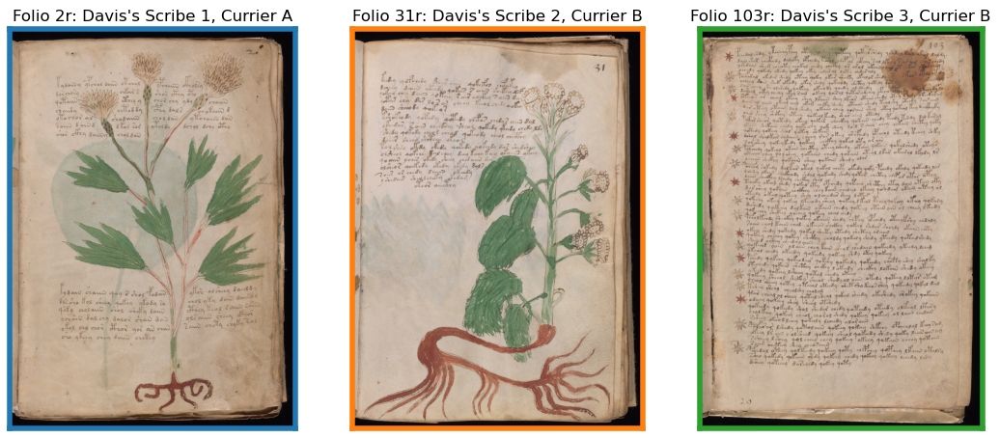
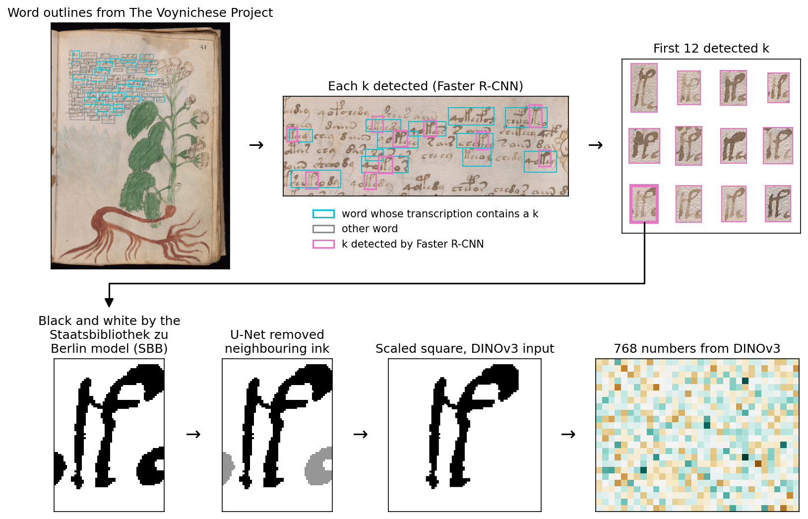
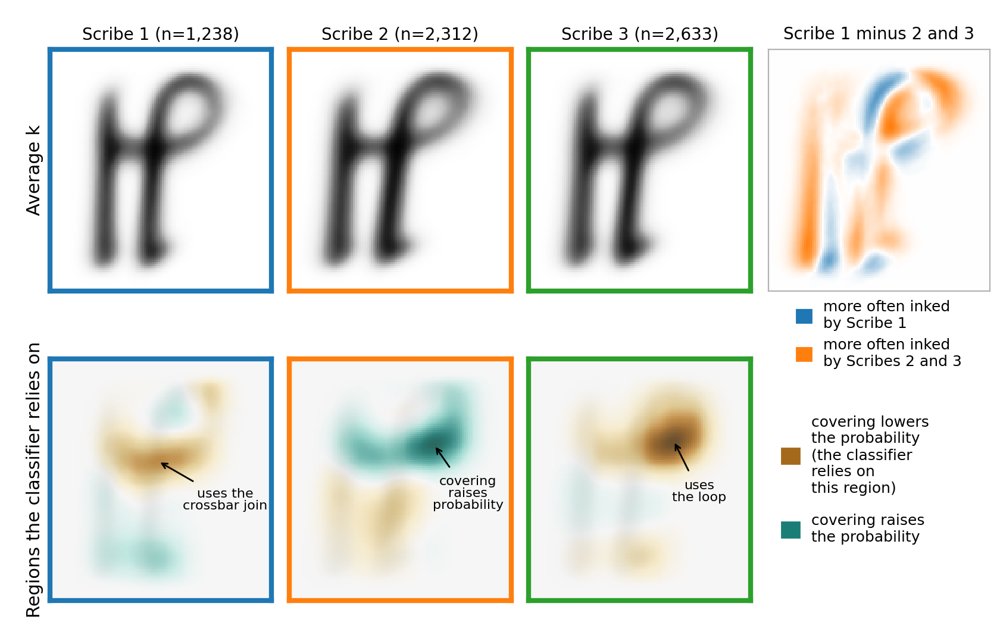
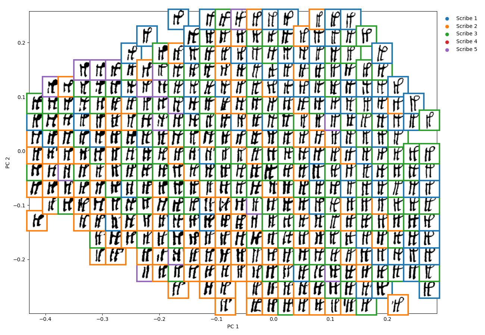
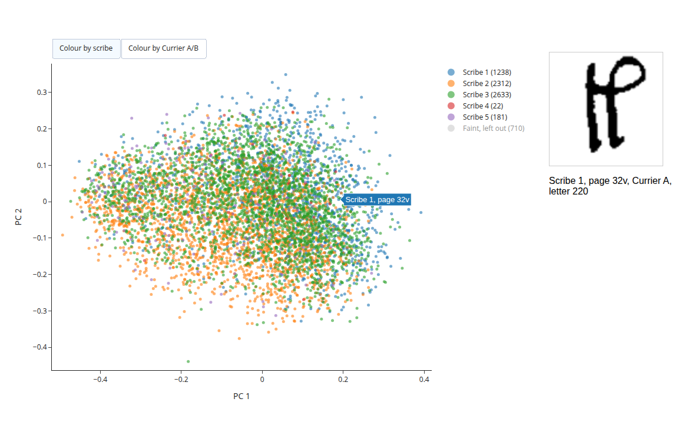
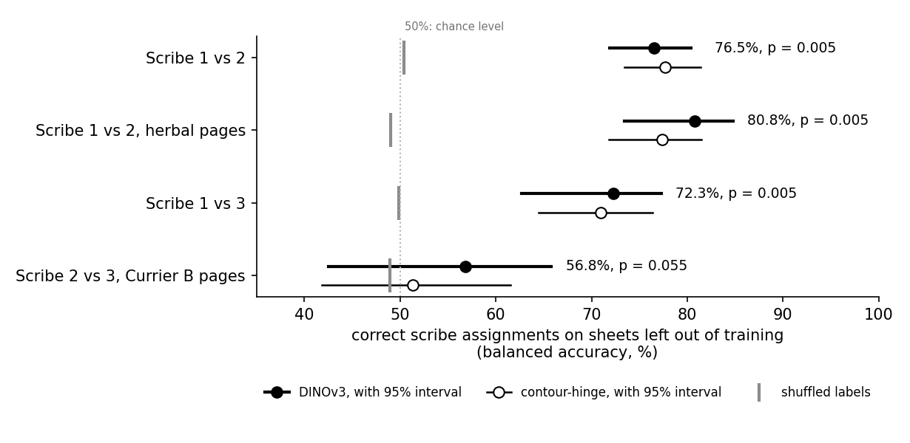
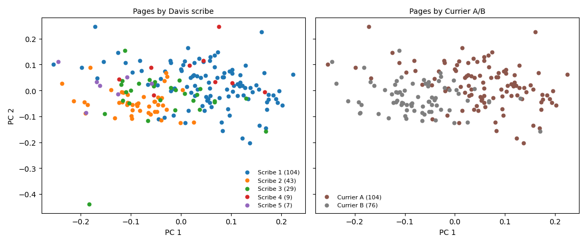
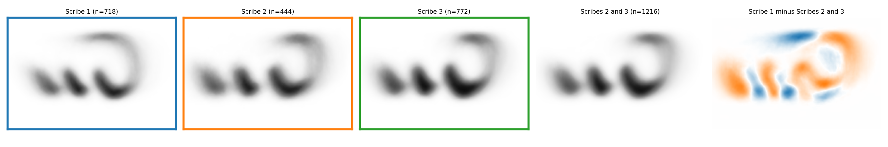
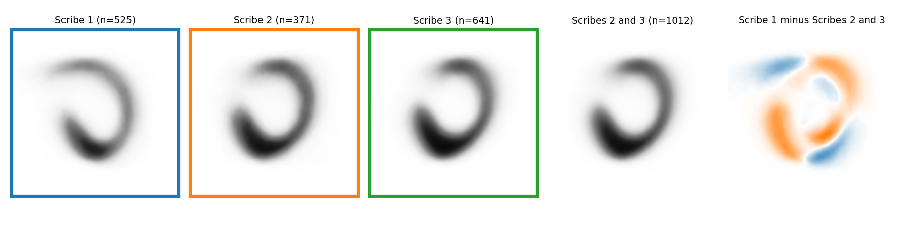

# How many scribes wrote the Voynich manuscript? Evidence from the letters `k` and `n`

**Abstract.** Palaeographers disagree on how many scribes wrote the Voynich manuscript. Lisa Fagin Davis identified five, mainly from the shape of one letter, `k`, while Torsten Timm argues that one person wrote the whole book. We found and cleaned every `k` and `n` we could by machine, described each one with a pretrained image model, and tested whether Davis's scribes can be told apart on parchment sheets held back from training. Scribe 1 can be told apart from Scribes 2 and 3, which matches the long-known split of the text into two varieties, A and B. Scribes 2 and 3 cannot be told apart reliably, and grouping the pages without Davis's labels gives a single group. Both letters give the same answer. Their shape differs between A and B pages, and no further division appears.

## Background



The Voynich manuscript is an illustrated 15th-century book in a script nobody has read (Yale, Beinecke MS 408). The argument over who wrote it has four steps.

- In 1976, the cryptologist Prescott Currier found that the text comes in two statistical varieties, A and B. He also saw two matching hands (styles of handwriting) among the plant drawings of the herbal section.
- In 2020, the palaeographer Lisa Fagin Davis [divided the book among five scribes](https://doi.org/10.1353/mns.2020.0011), mainly by the shape of `k`. In 2022 she named `n` as "an even-more determinative glyph". Her Scribe 1 wrote A, and Scribes 2, 3 and 5 wrote mostly B.
- In 2022, [Farrugia et al.](https://ceur-ws.org/Vol-3313/paper5.pdf) recovered Davis's scribes broadly from the transcribed text, but often confused Scribes 2 and 3. Because the text also changes with the subject of each section ([Sterneck et al. 2021](https://arxiv.org/abs/2107.02858)), a difference in the text may come from the subject rather than the writer.
- In 2026, Torsten Timm [argued](https://zenodo.org/records/19169450) that Davis's scribes reduce to A and B, written by one person who wrote more slowly and with more room on A pages.

This project measures the handwriting itself. Following Leif Denby's work on cloud images ([Denby 2020](https://doi.org/10.1029/2019GL085190)), each letter is described by a neural-network embedding. The embeddings are used to map every letter, to train a classifier on Davis's scribes, and to group the pages without her labels. A difference between Scribe 1 (A) and Scribes 2 and 3 (B) could be the A/B difference that both Davis and Timm accept. Only a difference between Scribes 2 and 3, who both wrote B, would support Davis's separate writers.

## Aims

1. Find and clean each `k` and `n` that the transcription records, with Faster R-CNN, the Staatsbibliothek zu Berlin model (SBB) and a U-Net.
2. Describe each letter with DINOv3, and show how the scribes' letters differ.
3. Test whether a logistic regression can tell Davis's scribes apart on sheets held back from training.
4. Test whether a Gaussian mixture model, given no scribe labels, finds separate groups of pages.

## Methods



**Finding and cleaning.** A Faster R-CNN detector, trained on Timm's hand-drawn boxes around `k`, searched each word that the transcription records as containing `k`. On pages held back from its training, it found 340 of Timm's 357 boxes. The SBB neural-network model turned each letter into black ink on white, and a U-Net trained for this project removed ink from neighbouring letters. The faintest tenth of the letters was left out, leaving 6,386. A blind review of 360 of these found 4% badly cleaned.

**Finding `n`.** Timm's boxes hold the ending `iin`, so the same steps were run on `iin`. They found 624 of his 677 boxes on held-out pages. Letters touching the top or left edge of their box were left out, because strokes from the line above join the ink there. A blind review of 360 found 7% badly cleaned. The `n` was then separated from each `iin` at the start of its last stroke, and letters whose strokes ran together were left out. That left 1,997 `iin` and 1,591 `n`.

**Embedding each letter.** Each letter was scaled into a fixed square without changing its proportions, so that shape rather than size was compared. DINOv3, Meta's pretrained image model, turned each letter into 768 numbers. The contour-hinge feature (Bulacu and Schomaker 2007), which describes the outline without a neural network, was used for comparison.

**Classifier tests.** For each pair of scribes, a logistic regression on the 768 numbers was tested by ten-fold cross-validation, with the four pages of each parchment sheet kept in the same fold. The result was the share of correct scribe assignments, with every page and both scribes weighted equally (balanced accuracy), so that chance is 50%. The 95% interval came from 1,000 resamples of the sheets, and the p-value from 200 refits with the scribe labels shuffled between sheets. Scribes 2 and 3 were compared on B pages only, so that the A/B split could not explain a difference. Scribes 4 and 5 had too few letters to test.

**Unsupervised classification.** The embeddings were averaged for each page, giving 192 page averages, and reduced to five principal components. A Gaussian mixture model was fitted without Davis's labels, with the number of groups chosen by BIC between one and eight. Groups with no dip in density between them were merged (Hennig 2010).

**Size and spacing.** Letter height, width and line spacing were measured on the page scans.

## Results

### What the letters look like



Scaled to the same height, the average `k` of Scribes 2 and 3 is wider than Scribe 1's (top row). The right panel shows where Scribe 1 (blue) or Scribes 2 and 3 (orange) more often put ink. In the bottom row, brown marks the regions the classifier relies on, because covering them lowers its confidence in the right scribe.



Each letter is placed on the first two principal components of the page averages, as in Denby's maps of cloud images. Narrow `k` with tall loops lie at the upper right, mostly by Scribe 1. Shorter, wider `k` lie to the left, mostly by Scribes 2 and 3. **Explore every letter yourself** in the [interactive map](https://raw.githack.com/LaineyLouiseWard/voynich-glyph-embeddings/master/outputs/maps/letters_map.html), for `k` or `n`, coloured by scribe or by Currier A/B.

[](https://raw.githack.com/LaineyLouiseWard/voynich-glyph-embeddings/master/outputs/maps/letters_map.html)

### Classifier tests on Scribes 1, 2 and 3



Scribe 1 can be told apart from Scribes 2 and 3. Scribes 2 and 3 cannot be told apart reliably, and the contour-hinge feature agrees. Their B pages lie on only 18 sheets, so the 95% interval is wide (43% to 66%) and a small difference cannot be ruled out.

### Unsupervised classification



The pages form one continuous spread, with A pages mostly on one side and B pages on the other. The mixture model found one group, and did so in 81% of 1,000 resamples. Forcing three groups did not recover Scribes 1 to 3.

### Size and spacing

Scribe 1's `k` is about a fifth taller than that of Scribes 2 and 3, and its lines are about a quarter further apart. Within each of Scribes 1 to 3, pages with wider spacing have taller `k`. At equal spacing, Scribe 1's `k` is still narrower for its height.

### The letter `n`





Scribe 1's `n` curl rises higher and varies more (paler average). Scribes 2 and 3 write a heavier, rounder lower curve (orange) and look alike.

| Balanced accuracy | `k` | `iin` | `n` |
|---|---|---|---|
| Scribe 1 vs 2 | 77% | 83% | 82% |
| Scribe 1 vs 3 | 72% | 86% | 83% |
| Scribe 2 vs 3 | 57%, p = 0.055 | 59%, p = 0.045 | 58%, p = 0.050 |

As with `k`, Scribe 1 is told apart from Scribes 2 and 3, and Scribes 2 and 3 sit just above chance. The `iin` p-value is just under 0.05, but its 95% interval reaches 42%, below chance, so this is not a reliable difference. The mixture model found one group for each letter.

## Conclusions

- Scribe 1's letters differ from those of Scribes 2 and 3, even within the herbal section, which fits the two hands Currier saw there. This is also the A/B split, so it fits both Davis's separate writers and Timm's one writer working in two ways.
- Davis's division of the B pages is not reproduced, with `k` or with `n`, the letter she calls more determinative. Scribes 2 and 3 are hard to tell apart, as Farrugia et al. found with the text. Scribe 3's `k` is also nearer Scribe 2's, although Davis calls it "similar to that of Scribe 1". We suggest that her division rests on features other than `k` and `n`, or on differences too small to detect with 18 sheets.
- Letter size rises with line spacing, as Timm's account predicts, but spacing does not account for the narrower shape of Scribe 1's `k`.
- The pages form one continuous group. This does not settle the number of writers, because the same method also merges Scribes 1 and 2, which can be told apart.

These findings concern `k` and `n`. The other tall letters called gallows (`t`, `p`, `f`) remain untested.

## Reproducing the results


<details>
<summary>Rebuild from the page scans (how the letters were found and cleaned; the 4 GB of scans are not in the repository)</summary>

Download Timm's [Archetype dataset](https://zenodo.org/records/18827108) to `data/raw/digipal_project/`, Zandbergen's [ZL3b-n.txt](https://www.voynich.nu/data/ZL3b-n.txt) to `data/raw/zandbergen/`, The Voynichese Project word boxes from [VoynichDuctus](https://github.com/silveremartin-dev/VoynichDuctus) to `data/raw/voynichese/`, and the [SBB code](https://github.com/qurator-spk/sbb_binarization) and [weights](https://huggingface.co/SBB/sbb_binarization) to `data/models/`. The two SBB steps need their own environment (`requirements-sbb.txt`). DINOv3 needs `huggingface-cli login`.

```bash
python scripts/crop_glyphs.py && python scripts/zl_page_labels.py
python scripts/sbb2022_masks.py                                    # SBB environment
python scripts/k_clean.py && python scripts/align_words.py
for n in 0 1 2 3 4; do python scripts/find_k.py --fold $n; done      # GPU
python scripts/find_k_report.py
for n in 0 1 2 3 4; do python scripts/sbb2022_found.py --fold $n; done   # SBB environment
python scripts/build_all_k.py && python scripts/unet_all_k.py         # GPU
python scripts/square_crops.py unet_all_k unet_all
python scripts/embed.py dinov3 unet_all --device cuda && python scripts/hinge_features.py --all
python scripts/letter_size.py && python scripts/pipeline_figure.py
# iin and n: the steps above with --letter iin, and iin_clean.py in place of k_clean.py, then
python scripts/cut_n.py && python scripts/square_crops.py unet_box_iin unet_all_iin && python scripts/square_crops.py unet_box_n unet_all_n
for s in iin n; do python scripts/embed.py dinov3 unet_all_$s --device cuda; done
```

</details>

<details>
<summary>Rerun the tests and figures (the letters and their numbers are included)</summary>

```bash
conda create -n voynich-glyph-embeddings python=3.11 pip && conda activate voynich-glyph-embeddings
pip install -r requirements.txt   # plus R 4.5 with requirements-r.txt
python scripts/davis_timm_tests.py dinov3_unet_all > outputs/classifier_tests/davis_timm_tests_dinov3_unet_all.txt
python scripts/davis_timm_tests.py hinge_unet_all > outputs/classifier_tests/davis_timm_tests_hinge_unet_all.txt
python scripts/pairs_and_blend.py dinov3_unet_all && python scripts/pairs_and_blend.py hinge_unet_all
python scripts/page_heaps_units.py dinov3_unet_all && Rscript scripts/page_heaps.R dinov3_unet_all
python scripts/three_groups.py && python scripts/line_spacing.py && python scripts/tests_figure.py
python scripts/average_k.py --all && python scripts/occlusion_k.py --all && python scripts/look_figure.py   # occlusion: GPU, about 30 min
python scripts/letters_map.py && python scripts/letters_hover.py && python scripts/page_spread.py
for s in dinov3_unet_all_iin dinov3_unet_all_n; do
  python scripts/davis_timm_tests.py $s > outputs/classifier_tests/davis_timm_tests_$s.txt
  python scripts/pairs_and_blend.py $s && python scripts/page_heaps_units.py $s && Rscript scripts/page_heaps.R $s
done
python scripts/average_k.py --letter iin && python scripts/average_k.py --letter n
```

</details>

## Credits

- Lisa Fagin Davis, for the five scribes and their `k` ("[How many glyphs and how many scribes?](https://doi.org/10.1353/mns.2020.0011)", *Manuscript Studies* 5(1), 2020; "[Voynich Paleography](https://ceur-ws.org/Vol-3313/keynote2.pdf)", 2022).
- Torsten Timm, for the case against them ("One Hand, Five Labels", [Zenodo 19169450](https://zenodo.org/records/19169450), 2026) and the hand-drawn boxes ([Archetype dataset](https://zenodo.org/records/18827108)).
- René Zandbergen, for the transcription that gives each page's text, language and scribe.
- The Voynichese Project (2014), for word boxes, found through [VoynichDuctus](https://github.com/silveremartin-dev/VoynichDuctus), the project that inspired this one.
- Leif Denby, whose cloud-image embeddings ([Denby 2020](https://doi.org/10.1029/2019GL085190); [2023](https://arxiv.org/abs/2309.08567)) and Aimsir course notebooks ([AIMSIR_convml_tt](https://github.com/leifdenby/AIMSIR_convml_tt)) were the model for the maps and the unsupervised classification.
- Olga Serbaeva Saraogi, whose notebook [DINOv2 for Paleographical Analysis](https://doi.org/10.5281/zenodo.20914632) (2026) groups handwritten letters by their DINOv2 embeddings. The first version of this project adapted it.
- Methods and models: [SBB binarisation](https://github.com/qurator-spk/sbb_binarization) (Staatsbibliothek zu Berlin), [DINOv3](https://huggingface.co/facebook/dinov3-vitb16-pretrain-lvd1689m) (Meta AI), U-Net (Ronneberger et al. 2015), Faster R-CNN (Ren et al. 2015), the contour-hinge feature (Bulacu and Schomaker 2007), mclust and fpc for the unsupervised classification (Hennig 2007, 2010).

## Licence

Code is [MIT](LICENSE). Timm's annotations are CC BY 4.0. The page scans belong to the [Beinecke Rare Book & Manuscript Library](https://collections.library.yale.edu/catalog/2002046) and are not in this repository, but the cleaned letters in `data/crops/` and some figures in `outputs/` are taken from them. The Voynichese word boxes and the SBB code are Apache 2.0.
