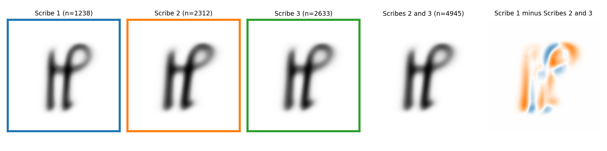
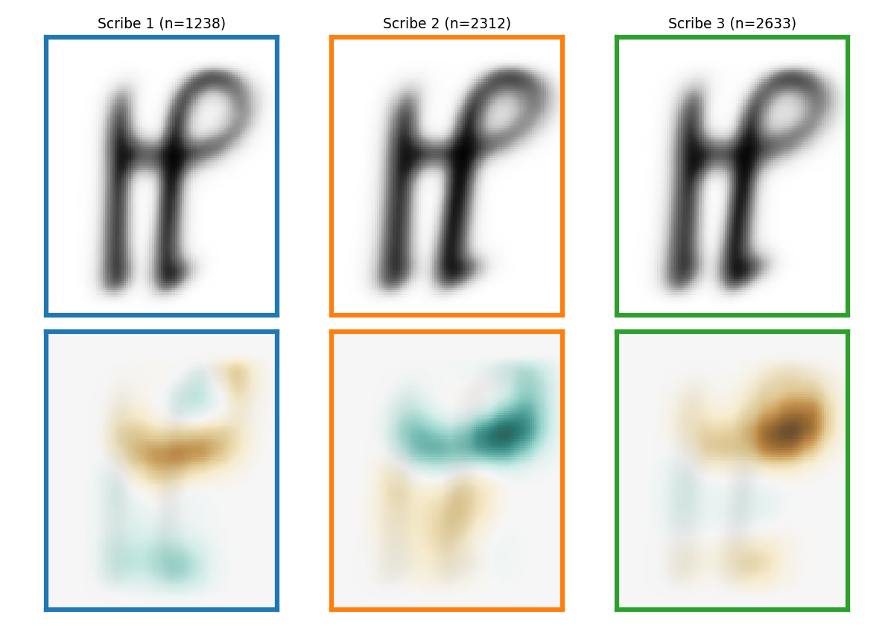
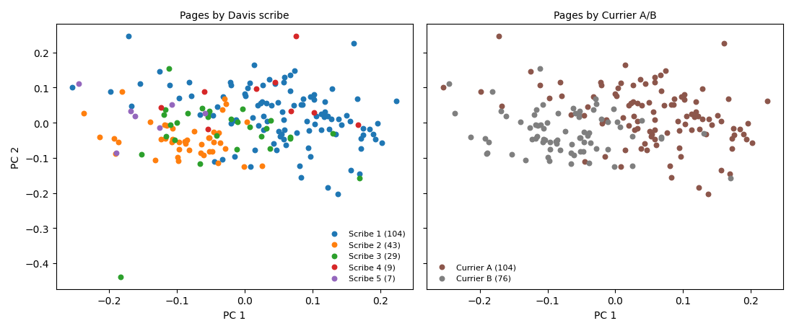
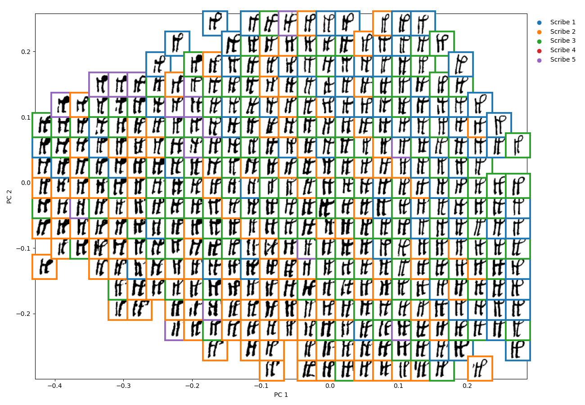
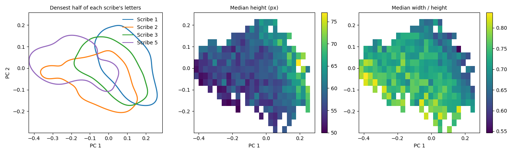

# Does the shape of `k` match Davis's five scribes?

Lisa Fagin Davis divided the Voynich manuscript among five scribes, mainly by how each wrote the letter `k`. This project finds every `k` it can by computer and measures its shape. It then tests whether the measurements are consistent with her scribes, or with Torsten Timm's view that her scribes reduce to Currier's A/B split of the text (explained below).

## The two claims

Davis (2022, *Voynich Paleography*) describes the `k` of her first three scribes.

> "The [k] character in Scribe 1 is distinguished by a sharp angle at the top of the first vertical as the quill changes direction, a bowed crossbar, a round loop, and a very slight foot at the base of the second vertical. Scribe 2 uses a horizontal, straight crossbar (indicating a lift of the pen after the completion of the first vertical), an oval loop, and an upwardly-angled final tick. The [k] written by Scribe 3 is similar to that of Scribe 1, although slightly more compact."

Timm (2026, *One Hand, Five Labels: A Critical Examination of the Five-Scribe Hypothesis for the Voynich Manuscript*, preprint, Zenodo 19169450) argues that "the five scribes reduce to pre-existing categories, with Scribes 1 and 2 replicating the Currier A/B language distinction". He explains the visible differences by writing conditions: "When a scribe writes slowly with ample space, strokes are longer and terminal flourishes more pronounced. When writing quickly in a cramped layout, strokes shorten and letterforms compress."

In the 1970s Prescott Currier divided the text itself into two statistical styles, A and B; words ending in "dy", for example, are common in B and rare in A. Davis's Scribe 1 writes only A; her Scribes 2, 3 and 5 write B, apart from two A pages by Scribe 3 (58r and 58v).

Davis used `k` shape to assign her scribes, so a `k` difference between her groups means only that her `k` criteria can be reproduced by computer. Counting it as separate evidence of separate writers would be circular. The two views cannot be told apart by comparing Scribe 1 with Scribes 2 and 3, because that is also a comparison of Currier A pages with Currier B pages. Scribes 2 and 3 both wrote B, so a difference between their `k` could not come from the A/B split. It would be evidence for Davis's division of the Currier B pages.

## Data and method

- **Letters.** René Zandbergen's transcription has about 10,200 `k` written on their own (not as part of `ckh`, a combined glyph that contains a `k`). The word outlines of The Voynichese Project (2014) could be placed on 166 pages, which hold 7,541 of them. A letter detector (Faster R-CNN) was trained on Timm's 432 hand-drawn `k` boxes (Archetype dataset, Zenodo 18827108) and run inside those words. It found 7,014 `k`. On pages left out of its training, it found 340 of Timm's 357 boxes. The 343 finds that repeat one of Timm's letters were dropped and 425 of Timm's boxes were added (7 tilted ones were left out). That gives 7,096 letters on 200 pages. Each letter is assigned Davis's scribe for its page. Page 115r is divided between Scribes 2 and 3 by line, as Davis divides it.
- **Cleaning.** Ink is first divided from parchment by the 2022 ink-separation (binarisation) model of the Staatsbibliothek zu Berlin (SBB). Neighbouring letters are then deleted by a small U-Net trained here on Timm's letters, which removes ink and adds none. Each letter is cleaned by a U-Net trained on neither side of its leaf (folio). The 10% of letters with the smallest share of ink pixels after cleaning are dropped as faint. That leaves 6,386 (Scribe 1 1,238, Scribe 2 2,312, Scribe 3 2,633, Scribe 4 22, Scribe 5 181). Scribes 4 and 5 are left out of the scribe comparisons but kept in the unsupervised classification and the maps. Most of Scribe 4's `k` are on pages whose text runs in rings, where few were found, and Scribe 5's are on two sheets (a sheet is one folded piece of parchment holding four pages).
- **Blind review of the cleaning.** 360 found letters drawn at random were rated blind to scribe and page. 15 had an error (4%), mostly a small piece of a neighbouring letter left touching the `k`. The error rate was 3% for Scribe 1, 6% for Scribe 2 and 3% for Scribe 3, all under the 10% limit set before the review.
- **Shape as numbers.** DINOv3 is a pretrained vision model, used here without retraining. It turns each letter image into an embedding, a list of numbers in which similar shapes get similar numbers. As a second measure that uses no neural network, each letter also gets the contour-hinge feature of Bulacu & Schomaker (2007, *IEEE TPAMI*, doi 10.1109/TPAMI.2007.1009). This is 300 numbers counting how often each pair of edge angles meets along the outline, as shares of the total. They are counted on the cleaned letter at its box size, without scaling.
- **Size.** Before DINOv3, each letter is padded to a square and scaled to the same size. The DINOv3 tests therefore compare shape but not size. Shape here includes how wide a letter is for its height. Size is measured separately on the page.
- **Scribe tests.** A logistic-regression classifier is trained on two scribes' letters from some sheets and assigns a scribe to each letter on the sheets left out of training. The result is the balanced accuracy. This is the share of each scribe's letters assigned correctly, averaged over the two scribes. Every page counts equally within its scribe, so pages with many letters do not dominate. Chance level comes from 200 runs with the labels shuffled between whole sheets. p = (1 + shuffled runs with balanced accuracy at least as high as with the real labels) / 201, so 0.005 is the smallest possible. The 95% range comes from 1,000 resamples of each scribe's sheets, with the classifier refitted each time.
- **Rule for Scribe 2 against 3, fixed in advance.** "Different" if p is under 0.05. "Alike" if even the top of the 95% range of balanced accuracy is under 60%, where 50% is chance level. Otherwise "can't tell".
- **Unsupervised classification.** Each page's average `k` (kept separate where a page has two scribes; 192 in all) is reduced to its first 5 principal components, the five directions in which page averages vary most (principal component analysis, PCA). A Gaussian mixture model, which describes the pages as a mix of bell-shaped clusters, is fitted to these. The number of clusters, from 1 to 8, is the one with the best BIC (Bayesian information criterion). Two clusters are joined into one group unless the density between them falls below 0.2 of the lower peak (the ridgeline ratio of Hennig 2010). Stability is tested on 1,000 resamples of sheets. The settings were fixed before running. Only then are the groups compared with Davis's scribes and with A/B.

## Results

| Test | Balanced accuracy, DINOv3 (contour-hinge) | Chance level, p | Verdict |
|---|---|---|---|
| Scribe 1 vs 2 | 77% (78%) | 50%, p = 0.005 | Different |
| Scribe 1 vs 2, herbal pages only (935 and 578 letters) | 81% (77%) | 49%, p = 0.005 | Different on the same kind of page |
| Scribe 1 vs 3 | 72% (71%) | 50%, p = 0.005 | Different |
| Scribe 2 vs 3, Currier B pages only (2,312 and 2,443 letters) | 57%, 95% range 43 to 66% (51%) | 49%, p = 0.055 (contour-hinge 0.27) | Can't tell |
| Scribe 2 vs 3, all pages | 56% (53%) | 49%, p = 0.055 (contour-hinge 0.13) | Can't tell |
| Unsupervised classification of pages (192) | 1 group; 81% of resamples also have 1 | Davis implies 5, Currier 2 | No separate groups |

- Scribe 2 against 3 is not "different" because p = 0.055 is above 0.05, so the 57% could arise by chance. It is not "alike" because the range reaches 66%, which leaves room for a modest real difference. With faint letters kept, the balanced accuracy is 58%, p = 0.055. The limit is the number of sheets. Scribe 3's Currier B letters are on 7 sheets and Scribe 2's on 12, and more letters per page do not add sheets.
- A classifier trained on Scribes 1 and 2 labels as Scribe 1 83% of Scribe 1's letters and 14% of Scribe 2's (both on sheets left out of training), and 36% of Scribe 3's, which it was never trained on (contour-hinge 30%). Scribe 3's `k` is much closer to Scribe 2's than to Scribe 1's, while Davis describes it as "similar to that of Scribe 1".
- In the unsupervised classification, a Gaussian mixture model with two clusters had the best BIC. The density between them does not dip at all (ridgeline ratio 1), so they are joined into one group. There are no groups to compare with Davis's scribes or with A/B.
- Splitting into three groups with two standard clustering methods, k-means and Ward clustering (`scripts/three_groups.py`, `outputs/unsupervised_classification/three_groups.txt`), does not recover Scribes 1 to 3. Agreement is the adjusted Rand index (1 = same grouping, 0 = no better than chance). On single letters every group mixes all three scribes (agreement with Davis 0.00 to 0.01). On page averages one or two groups are mostly Scribe 1 (73% to 89%), but Scribes 2 and 3 never get separate groups (agreement with Davis 0.30 to 0.33, with A/B 0.29 to 0.44).

## Letter size

| | Height of the `k` on the page (median, scan pixels) | Width / height |
|---|---|---|
| Scribe 1 | 68 | 0.66 |
| Scribe 2 | 56 | 0.75 |
| Scribe 3 | 57 | 0.72 |
| Scribe 5 (181 letters, two sheets) | 60 | 0.71 |
| Herbal pages only: Scribe 1, Scribe 2 | 68, 59 | |

Scribe 1's `k` is about a fifth taller than Scribe 2's and Scribe 3's, and narrower for its height. Scribes 2 and 3 are the same size. The scans share one scale (page images 3,693 to 3,890 pixels tall for all three scribes), so the difference is in the letters, not the scans. Scribes 1 and 2 both write herbal pages, often on interleaved sheets in the same quires (sets of sheets folded together). On herbal pages too, Scribe 1's `k` is taller. Davis describes Scribe 1's writing as "broadly spaced" (Davis 2021, a forum post, quoted in Timm 2026). Timm treats the same broad spacing as a writing condition of one hand, in which strokes are longer. The taller `k` is consistent with both explanations. Davis describes Scribe 5's `k` as "tall, narrow"; here it is shorter and wider than Scribe 1's.

Line spacing was measured in two independent ways (`scripts/line_spacing.py`, `outputs/size_and_spacing/line_spacing.txt`). One uses the placed word outlines (median gap between consecutive line centres), the other the ink (the bottoms of the `k` boxes on consecutive transcription lines). On the 162 pages with both, the two measures have a rank correlation (Spearman) of +0.76 and a median absolute difference of 2.3 pixels. Scribe 1's lines are about a quarter further apart (median 80 pixels against 62 to 65). Within every scribe, pages with wider line spacing have taller `k` (rank correlation +0.43 to +0.67, either measure). A least-squares fit over pages on line spacing plus a Scribe 1 term gives the Scribe 1 difference at equal spacing. Its 95% ranges come from 2,000 sheet resamples. At equal spacing, Scribe 1's `k` stays narrower for its height under both measures. The width / height term is -0.036 (95% range -0.068 to -0.006) from the word outlines and -0.041 (range -0.066 to -0.019) from the `k`. Whether it also stays taller depends on the measure: +2.3 pixels (range -0.5 to +5.9) from the word outlines, +4.6 (range +2.2 to +8.0) from the `k`. So at equal spacing part of the height difference disappears, possibly most of it, as Timm's cramped-writing argument predicts. The narrower shape remains. Currier A and B pages overlap little in spacing, so the equal-spacing comparison depends on few pages. These measurements also cannot show whether more room makes bigger letters or bigger writing needs more room.

## Average `k`

Every letter is scaled to the same height and centred on its ink before averaging, so each pixel shows the share of letters with ink there. In the right panel, blue marks spots more often inked by Scribe 1 and orange spots more often inked by Scribes 2 and 3. The largest difference at any spot is 30% of letters. Both vertical strokes are orange. Once heights are equal, Scribes 2 and 3 write a wider `k`, consistent with the width / height values above. Most of the other differences are on the loop.

## Regions the classifier relies on

The occlusion maps were made by passing all 6,183 letters of Scribes 1 to 3 again through DINOv3 and a logistic-regression classifier for Scribes 1 to 3 that was trained without that letter's sheet. Each time a white square of 32 by 32 pixels covered one region of the 224 by 224 pixel image, moved in steps of 16 pixels. Brown shows regions where covering lowers the probability the classifier assigns to the letter's own scribe; these are regions the classifier relies on. Teal shows regions where covering raises it. The pattern matches an earlier run on 300 letters per scribe.

- Scribe 1: covering a band at crossbar height, where the crossbar meets the upright of the loop, lowers the Scribe 1 probability most.
- Scribe 2: covering the same band raises the Scribe 2 probability, and covering the loop raises it most. So when those regions are visible, the classifier assigns more probability to Scribes 1 and 3.
- Scribe 3: covering the loop lowers the Scribe 3 probability more than covering any region lowers it for Scribe 1 or 2.
- The covered square is about a seventh of the image wide, so locations are approximate.

## The page and letter maps

On the first two principal components of the page averages, Scribe 1 (Currier A) is mostly to the right and Scribes 2 and 3 (Currier B) to the left, with no gap between them. The components are computed without scribe labels. The letter map has the same pattern: narrow `k` with tall loops at the upper right, mostly Scribe 1; wider `k` with thicker strokes to the left and bottom, mostly Scribes 2 and 3; and Scribe 3's letters mixed in with both.

Each line in the left panel surrounds the densest half of one scribe's letters (Scribe 4 has too few letters for a line). Scribe 1's densest half is to the right and Scribe 2's and Scribe 5's to the left. Scribe 3's is between them and overlaps both. In the other two panels the map is coloured by measured features of the letters, as Denby (2023) did for cloud images. Letters further right are taller on the page (rank correlation with the left-right position +0.35 over all letters, +0.20 to +0.38 within each of Scribes 1 to 3) and narrower for their height (-0.23). Every letter was scaled to the same size before DINOv3, so the link between map position and size must come through some other property of the image. Stroke thickness is a likely one, because a small letter scaled up gets thicker strokes. That is an inference, not tested. Scribes 2 and 3 are the same size, so this link to size does not affect their comparison.

A curved map made with Isomap, the method Denby preferred, also has no gap. Unlike PCA, Isomap does not assume the numbers lie on a flat plane. A 25-nearest-neighbour classifier was given only map position and tested on held-out sheets. For Scribe 1 against Scribes 2 and 3, its balanced accuracy is 52% on Isomap and 56% on the PCA map of page averages, where 50% is chance level (`outputs/maps/isomap_check.txt`).

## What it means

- Scribe 1's `k` differs from Scribe 2's and Scribe 3's on sheets left out of training, and it is taller. Scribe 1 writes only Currier A and Scribes 2 and 3 almost only Currier B, so this is also the A/B split. It is equally consistent with Davis's separate writers and with Timm's one hand writing more slowly in A's wider spacing. The two cannot be told apart by these tests.
- Scribes 2 and 3 both wrote Currier B, and their `k` cannot be told apart. There is no reliable evidence in the `k` that they are different writers, which is the split that would show Davis's scribes are more than A/B. Nor is there evidence that they are the same writer.
- Scribe 3's `k` is close to Scribe 2's, not to Scribe 1's as Davis describes.
- In the unsupervised classification the pages form one continuous spread, with Currier A pages mostly on one side and Currier B pages on the other, and no separate groups.
- So the differences in the shape of `k` match the A/B division, and nothing reliable is found beyond it. Whether one hand wrote the whole book is a separate question that these tests leave open.

## Limits

- 7,541 of the roughly 10,200 `k` are on pages where word outlines could be placed; fold-out pages and pages whose word outlines could not be matched to the scan are missing.
- Scribe 1 against Scribe 2 can never be separated from text type A against B, or from the wider spacing of Currier A pages.
- Letters are scaled to one size, but the map's left-right axis (first principal component) still correlates with letter size, probably through stroke thickness. So the Scribe 1 against 2 shape difference may partly be a size difference.
- Scribes 2 and 3 mostly wrote different sections (Scribe 2 mostly herbal and bathing pages, Scribe 3 mostly starred-paragraph pages), so section still differs in their comparison.
- The Scribe 2 against 3 test uses 18 sheets (12 with Scribe 2's Currier B letters, 7 with Scribe 3's, one with both), which limits how precise it can be.
- The method uses shape only, not stroke order, and part of Davis's case rests on stroke order.
- We assume EVA `k` (the letter as coded in EVA, the standard Voynich transcription alphabet) is one letter; shape alone cannot rule out two look-alike letters.
